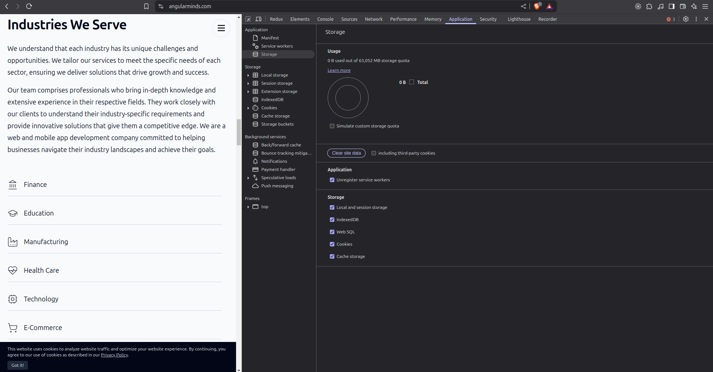
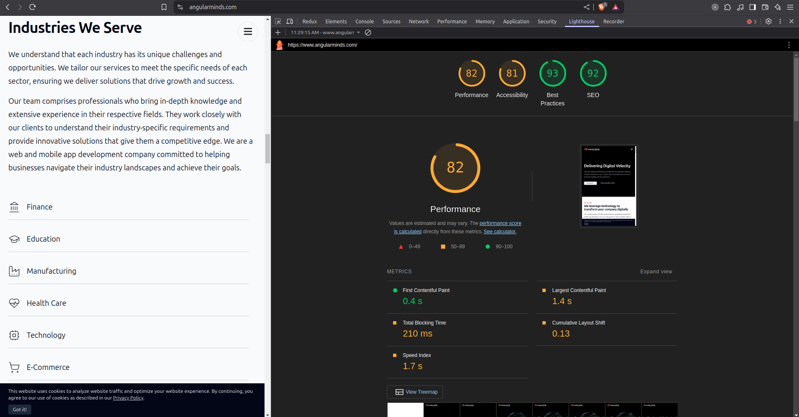
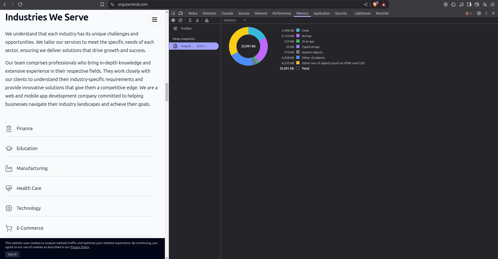
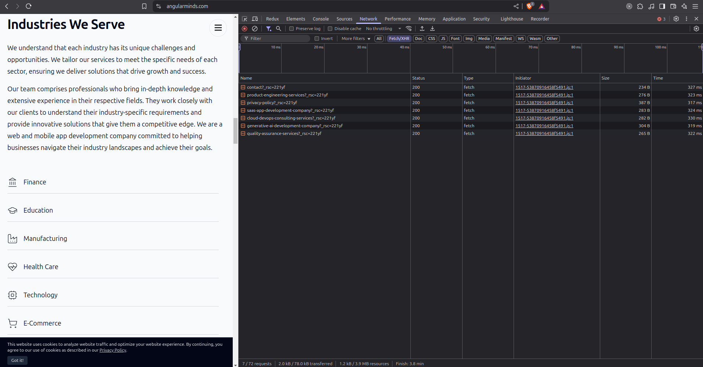
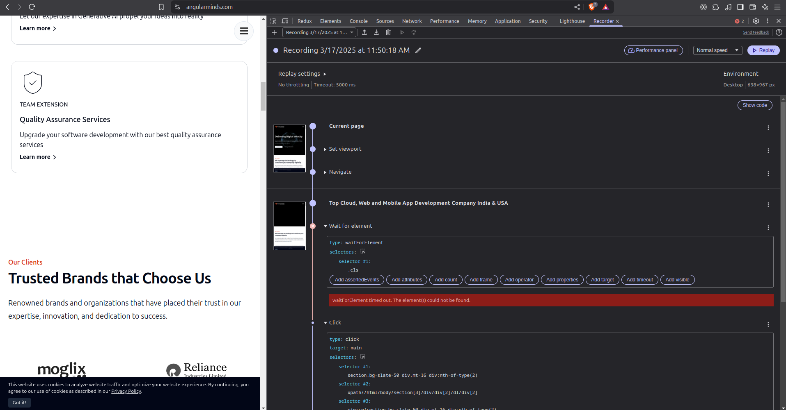
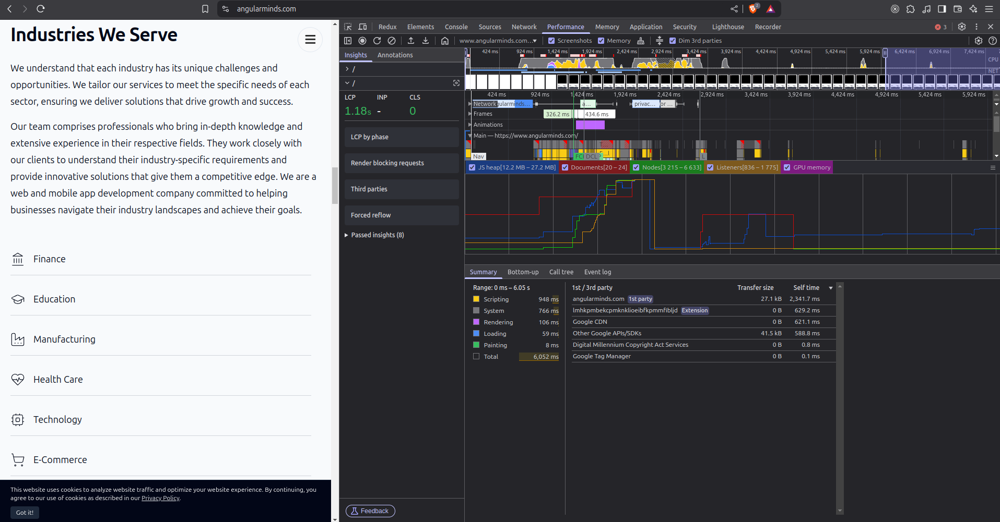

# Angular Security Best Practices: 

### 1. Preventing cross-site scripting (XSS):

* In XSS attack, enables attackers to inject malicious code into web pages (e.g steal user and login data)

* Attackers can inserting a ```<script>``` tag in the DOM, they can run arbitrary code on your website.

* To prevent this vulnerabilities, always use the default Ahead-Of-Time (AOT) template compiler in production deployments.

* Sanitize untrusted values with the DomSanitizer.sanitize method and the appropriate SecurityContext

1. bypassSecurityTrustHtml
2. bypassSecurityTrustScript
3. bypassSecurityTrustStyle
4. bypassSecurityTrustUrl
5. bypassSecurityTrustResourceUrl

```js
    constructor(private sanitizer: DomSanitizer) {
    // javascript: URLs are dangerous if attacker controlled.
    // Angular sanitizes them in data binding, but you can
    // explicitly tell Angular to trust this value:
    this.dangerousUrl = 'javascript:alert("Hi there")';
    this.trustedUrl = sanitizer.bypassSecurityTrustUrl(this.dangerousUrl);
    }

```

* Content Security Policy (CSP) is a defense-in-depth technique to prevent XSS

* Use HTTP-only Cookies for Session Management. HTTP-only cookies can only be accessed by the server, not JavaScript running on the client side. This means they can’t be accessed or manipulated by malicious scripts that may run in the browser, protecting against XSS attacks.


### 2. Cross-site request forgery

In a Cross-Site Request Forgery (CSRF) attack, an attacker tricks a logged-in user into making a malicious request to a website, like transferring money. To prevent this, the website sends a unique token with each request, and the user’s browser must send this token back in a custom header. This ensures that only the legitimate site can send and read the token, blocking malicious requests from other sites.

This technique is effective because all browsers implement the same origin policy. Only code from the website on which cookies are set can read the cookies from that site and set custom headers on requests to that site. That means only your application can read this cookie token and set the custom header. The malicious code on evil.com (hacker site) can't.


 When performing HTTP requests, an interceptor reads a token from a cookie, by default XSRF-TOKEN, and sets it as an HTTP header, X-XSRF-TOKEN. Because only code that runs on your domain could read the cookie, the backend can be certain that the HTTP request came from your client application and not an attacker.


### 3. ross-site script inclusion (XSSI):

Cross-site script inclusion (JSON vulnerability) allows an attacker to read data from a JSON API by injecting a script tag. To prevent this, servers add a ```")]}',\n"``` prefix to JSON responses, making them non-executable. Angular's HttpClient library automatically strips this prefix before parsing the response, blocking the attack.


--- 

Here are the main points for maintaining Angular app security:

1. **Use HTTPS** for all communications.
2. **Implement proper authentication and authorization** (e.g., JWT, OAuth).
3. **Sanitize user input** to prevent XSS (Cross-Site Scripting).
4. **Enable Content Security Policy (CSP)** to control external resources.
5. **Avoid exposing sensitive data in the frontend** (e.g., API keys).
6. **Use Angular's built-in sanitization** (`DomSanitizer`) when working with dynamic content.
7. **Update dependencies regularly** to patch known vulnerabilities.
8. **Use secure cookies** (HttpOnly, Secure, SameSite).
9. **Use Role-based Access Control (RBAC)** for different user privileges.
10. **Use CSRF protection** to prevent Cross-Site Request Forgery.
11. **Implement logging and monitoring** for unusual behavior.
12. **Avoid using `eval()` or `Function()`** in the app code.
13. **Set proper HTTP headers** (e.g., X-Content-Type-Options, X-Frame-Options).
14. **Minify and obfuscate production code** to make it harder to reverse-engineer.


---
---

# Improve Angular Application Performance and Optimization:

1. Use trackBy in ngFor loops: This will prevent Angular from re-rendering the entire template for each item in the collection.

2. Use lazy loading: reducing the size of the initial bundle that is downloaded by the browser

3.  Use OnPush change detection strategy: This strategy only checks for changes when the application state is explicitly changed.

4. Avoid Memory Leaks: Unsubscribe from Observables when no longer needed.

5. Use Pure Pipes: Avoid recalculating values unnecessarily.

6. Use AOT compilation

7. Optimize Third-Party Libraries

8. use Web Workers: allow you to run code in the background

9. Use performance profiling tools: can help you to identify the areas of your application that are causing performance problems

10. Use a CDN to load static asset. 

11. Optimize your images

12. Use a caching strategy


---

# Test Angular App performance, Security, Memory & other details:


- Code - SonarQube
- Functional, accessibility- DevAxeTool, angular Dev tools
- Event Tracking - Google analytics
- User traffic monitor - datadog + google analytics
- SEO, Web vitals, web loading time - Sentry

#### Web Vitals: 

Core Web Vitals is a set of metrics that measure real-world user experience for loading performance, interactivity, and visual stability of the page. We highly recommend site owners achieve good Core Web Vitals for success with Search and to ensure a great user experience generally. This, along with other page experience aspects, aligns with what our core ranking systems seek to reward.


###### Core Web Vitals metrics:

- Largest Contentful Paint (LCP): Measures loading performance. To provide a good user experience, strive to have LCP occur within the first 2.5 seconds of the page starting to load.

- Interaction To Next Paint (INP): Measures responsiveness. To provide a good user experience, strive to have an INP of less than 200 milliseconds.

- Cumulative Layout Shift (CLS): Measures visual stability. To provide a good user experience, strive to have a CLS score of less than 0.1.

---

# Chrome Devtools: 

### 1. **Application Tab**
   - **Purpose**: Helps you inspect and manage the resources your web application uses.
   - **Key Features**:
     - **Local Storage, Session Storage**: View data stored in web storage.
     - **IndexedDB**: Inspect database data stored on the client side.
     - **Cache Storage**: Check service worker caches.
     - **Cookies**: View and manage cookies used by your app.
     - **Service Workers**: See active service workers, their status, and debug them.

     

### 2. **Lighthouse Tab**
   - **Purpose**: Provides audits to assess the performance, accessibility, SEO, and best practices of your Angular application.
   - **Key Features**:
     - **Performance Score**: Gives a performance score based on various criteria (e.g., load time, interactivity).
     - **Audits**: Shows performance issues, such as slow loading or inefficient resource handling, and provides suggestions for improvement.
     - **Core Web Vitals**: Measures important metrics like Largest Contentful Paint (LCP), First Input Delay (FID), and Cumulative Layout Shift (CLS).

     

### 3. **Memory Tab**
   - **Purpose**: Used to identify memory usage issues like leaks or excessive memory consumption.
   - **Key Features**:
     - **Heap Snapshot**: Inspect memory allocation and find objects that are taking up memory.
     - **Allocation instrumentation on timeline**: Records memory allocation events, helping to track performance issues over time.
     - **Memory Leaks**: Identifies objects that are not being garbage collected, which may indicate leaks.

      

### 4. **Network Tab**
   - **Purpose**: Helps to inspect network requests made by the Angular application.
   - **Key Features**:
     - **Request Timing**: Analyze the time spent in DNS lookup, initial connection, and response time for API calls or asset loading.
     - **Request Details**: View headers, payload, and responses for HTTP requests.
     - **Performance Bottlenecks**: Look for issues like slow network responses, large payloads, or excessive request times.
     - **Throttle Network**: Simulate slower network conditions to understand how your app performs under various speeds.

     

### 5. **Recorder Tab**
   - **Purpose**: Enables recording user interactions with your application to analyze their performance.
   - **Key Features**:
     - **Record User Actions**: Allows you to record sequences of user interactions (e.g., clicks, scrolls).
     - **Performance Analysis**: Review the recorded interactions to analyze any performance bottlenecks related to user actions.
     - **Replays**: Replay the recorded interactions while tracking network and performance data.

     

### 6. **Performance Tab**
   - **Purpose**: The main tab for tracking and analyzing overall performance of your Angular application.
   - **Key Features**:
     - **Frames & Timings**: Provides a visual timeline of activities like scripting, rendering, painting, and layout operations.
     - **CPU & Memory Usage**: Identifies areas of your app that are consuming a lot of CPU or memory resources.
     - **JavaScript Execution**: View how long each JavaScript function took to execute and detect any slow functions that could affect performance.
     - **Repaints & Reflows**: Analyze layout and rendering performance to see if there are any expensive reflows or repaints.

     


These tools are essential for identifying performance bottlenecks in Angular applications, from slow network requests to memory issues or inefficient rendering.


