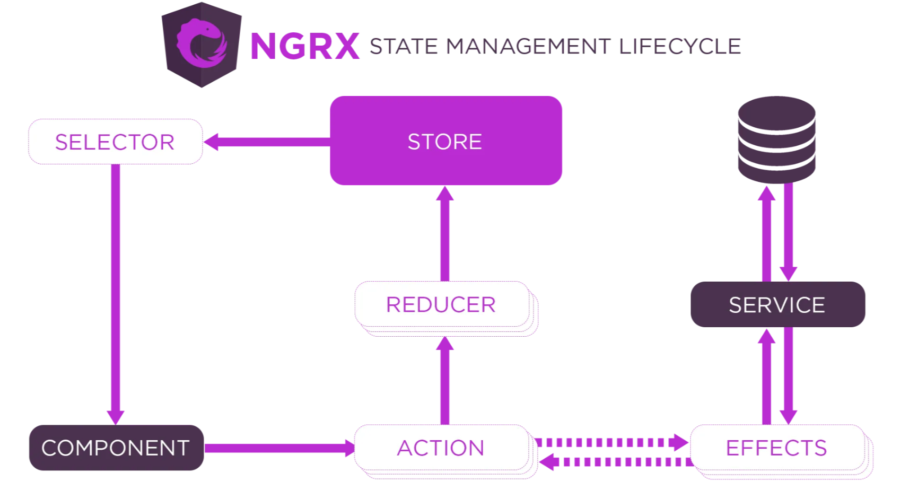

## NGRX:

NgRx is a reactive state management library for Angular applications that leverages the power of RxJS to manage the state and interactions in the application. It is often used to handle complex state management in larger Angular applications by using a store that provides a single source of truth for the app's state, and actions and reducers to modify it.

---


---

```js
* Key Concepts of NgRx: 

1. Store: Centralized state container holds the state of the entire application in a single immutable object.

2. Actions: Actions are payloads of information that send data from your application to the store.

3. Reducers: Functions that specify how the application’s state changes in response to actions.

4. Selectors: Selectors provide a way to efficiently compute derived data from the store.

5. Effects: Side-effects management, usually for API calls or other asynchronous operations.

6. Dispatch: To send actions to the store.

```

---

Why Use NgRx?

```js
1. Predictable State Management: NgRx enforces a unidirectional data flow, 
                                 making it easier to understand and predict how data changes in the application.

2. Efficient Debugging: With the help of the Redux DevTools, developers can easily trace and debug state changes.

3. Scalability: NgRx scales well as your application grows, 
                providing a structured and maintainable way to handle state.

4. Reusability: Actions, reducers, and selectors can be reused across components, enhancing code modularity.

5. Improving Performance: NGRX optimizes performance by reducing the number of redundant state changes.

```

---

Steps to implement ngrx in angular app:

Step 1: nstall NgRx in Angular

```js
ng add @ngrx/store
ng add @ngrx/effects

```

Step 2: Generate Actions, Reducers, and Effects:

```
ng generate action actions/my-action
ng generate reducer reducers/my-reducer
ng generate effect effects/my-effect

```

Step 3: Update AppModule:

```js
@NgModule({
  imports: [
    StoreModule.forRoot({ myReducer: myReducer }),
    EffectsModule.forRoot([MyEffect]),
  ],
})

```

Step 4: Dispatch Actions in Components:

```js
this.store.dispatch(myAction({ payload: data }));
```

Step 5: Select Data in Components:

```js
this.data$ = this.store.pipe(select(selectMyData));
```

<!-- learn - createActionGroup, emptyProps.  -->

---

### CRUD Operation using NgRx:

* Create Model:

```js
// src/app/task.model.ts

export interface Task {
  id: number;
  title: string;
  description: string;
}

```

* Create Actions:

```js

// src/app/task.actions.ts

import { createAction, props } from '@ngrx/store';
import { Task } from './task.model';

export const addTask = createAction('[Task] Add Task', props<{ task: Task }>());
export const updateTask = createAction('[Task] Update Task', props<{ task: Task }>());
export const deleteTask = createAction('[Task] Delete Task', props<{ id: number }>());

```

Here, The first argument of createAction is the action type, enclosed in square brackets to indicate it belongs to the Task feature. The second argument, props, is used to define the payload of the action. In our case, addTask and updateTask actions expect a task object, while deleteTask expects an id as the payload.


* Create Reducer:

```js
// src/app/task.reducer.ts

import { Task } from './task.model';
import { addTask, updateTask, deleteTask } from './task.actions';

export interface AppState {
  tasks: Task[];
}

export const initialState: AppState = {
  tasks: []
};

export function taskReducer(state = initialState, action): AppState {
  switch (action.type) {
    case addTask.type:
      return { ...state, tasks

: [...state.tasks, action.task] };
    case updateTask.type:
      return {
        ...state,
        tasks: state.tasks.map(task => (task.id === action.task.id ? action.task : task))
      };
    case deleteTask.type:
      return { ...state, tasks: state.tasks.filter(task => task.id !== action.id) };
    default:
      return state;
  }
}

```

Here, Imported the actions and added cases to our taskReducer function to handle each action type. For addTask, we create a new state by adding the new task to the existing tasks array. For updateTask, we map through the tasks and update the one with a matching id. For deleteTask, we filter out the task with the specified id.


* Create Selectors:

Selectors in NGRX are used to access specific pieces of state from the store. They allow us to compute derived data based on the state and avoid accessing the state directly.


```js
// src/app/task.selectors.ts

import { createSelector } from '@ngrx/store';
import { AppState } from './task.reducer';

export const selectTasks = (state: AppState) => state.tasks;

export const selectTaskById = (id: number) =>
  createSelector(selectTasks, tasks => tasks.find(task => task.id === id));


```

Here, The selectTasks selector retrieves the tasks array from the state, while selectTaskById takes an id argument and returns the task with the corresponding id.

* Dispatching Actions:

Now that we have set up the store, defined actions, and implemented reducers and selectors, let's move on to dispatching actions from our components.

```js
// src/app/app.component.ts

import { Component } from '@angular/core';
import { Store } from '@ngrx/store';
import { AppState } from './task.reducer';
import { addTask, updateTask, deleteTask } from './task.actions';
import { Task } from './task.model';

@Component({
  selector: 'app-root',
  templateUrl: './app.component.html',
  styleUrls: ['./app.component.css']
})
export class AppComponent {
  tasks: Task[] = [];

  constructor(private store: Store<AppState>) {
    this.store.select('tasks').subscribe(tasks => this.tasks = tasks);
  }

  addNewTask() {
    const newTask: Task = {
      id: this.tasks.length + 1,
      title: 'New Task',
      description: 'This is a new task.'
    };
    this.store.dispatch(addTask({ task: newTask }));
  }

  updateTask(task: Task) {
    const updatedTask: Task = { ...task, title: 'Updated Task', description: 'This task has been updated.' };
    this.store.dispatch(updateTask({ task: updatedTask }));
  }

  deleteTask(id: number) {
    this.store.dispatch(deleteTask({ id }));
  }
}

```

Here, Defined methods to add, update, and delete tasks and dispatched the corresponding actions using the store.dispatch() method.


* Displaying Data in Components:

Now that we can dispatch actions, let's create the user interface to display our tasks and allow users to add, update, and delete them.


```html

<!-- src/app/app.component.html -->

<div *ngFor="let task of tasks" class="task">
  <h3>{{ task.title }}</h3>
  <p>{{ task.description }}</p>
  <button (click)="updateTask(task)">Update</button>
  <button (click)="deleteTask(task.id)">Delete</button>
</div>
<button (click)="addNewTask()">Add New Task</button>


```

Here, In this HTML template, we use Angular's *ngFor directive to loop through the tasks and display their titles and descriptions. We also add buttons to update and delete each task and a button to add a new task.


