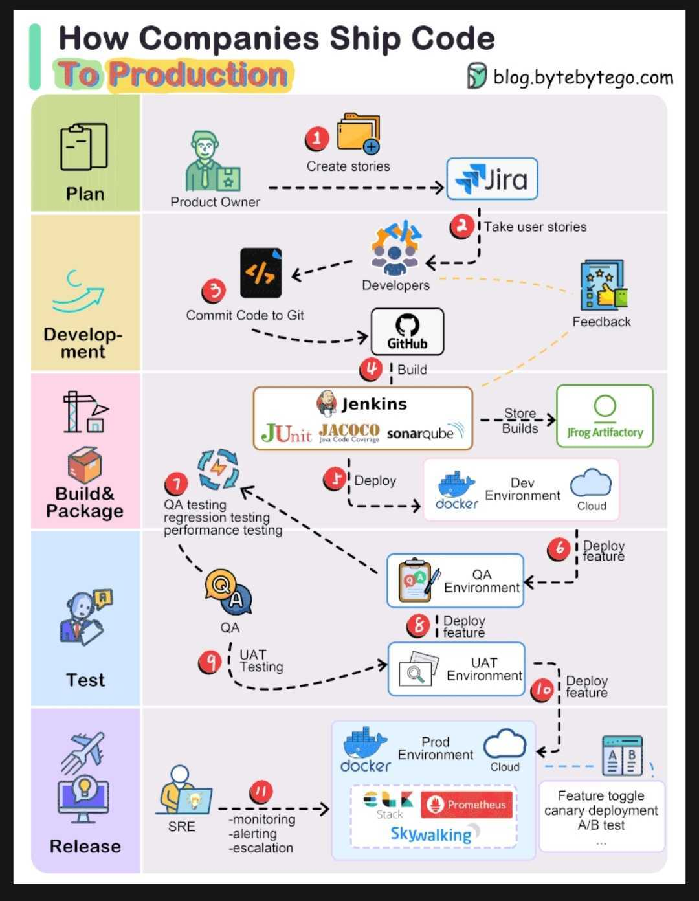

Project Dev life cycle:

1. Requirement gathering and planning:

- Product Owners: 

These individuals work closely with stakeholders to understand user needs and translate them into detailed user stories.

- Agile :

Teams often use Agile methodologies to orgnize work into sprints, tpyically two weeks long.

2. Development and Version control:

- Developers: 

Write the code that brings user stories to life.

- Git:

A version control system that tracks changes to the codebase, making collaboration easier.

- Continuous Integration: 

Developers frequently merge their code into a shared repository, triggering automated builds and tests to catch errors early.

3. Builds and Quality Assurance:

- Jenkins (or similar CI/CD tools):

These tools automate the build process, compiling the code and running initial tests.

- SonarQube:

A code quality tool that analyzes the code for potential issues, vulnerabilities and adherence to coding standards.

- Artifact Repository (e.g Artifactory):

Stores successful builds for later deployment.

4. Testing in multiple Environments:

- Development Environment:

Developers test their code in isolation.

- QA Environment (QA1,QA2,etc):

Dedicated environments where QA teams rigorously test features for functionality, performance and security.

They may use techniques like:

- Regression testing: 

Ensuring new changes haven't broken existing functionality.

- Exploratory Testing: 

Testing beyond scripted case to uncover unexpected issues.

- User Acceptance Testing (UAT) : 

A final round of testing in a production-like environment to confirm the software meets user requirements.

5. Deployment to Production:

- Release candidates:

Builds that pass UAT are deemed ready for release.

- Deployment strategies:

Blue-Green deployment
Canary Deployment

6. Monitoring and Site Reliability:

- Site reliability engineering (SRE) :

Teams responsible for ensuring the system's performance, availability and scalability in production.

- Monitoring tools:

These tools collect real-time data on application health, user experience and infrastructure performance, allowing SREs to quickly detect and address issues.

